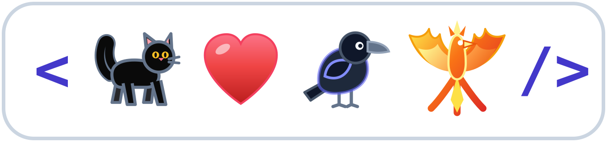

# José Alberto Molina Abellán · eker &nbsp;
### Desarrollador de Software · Kotlin / KMP & Full-Stack · Creador de AlarmGest, Entreturno y Biotopo

  <a href="https://www.eker.es">&nbsp;<b>eker.es</b></a>
  &nbsp;&nbsp;•&nbsp;&nbsp;
  <a href="https://www.linkedin.com/in/josealbertomolina/">&nbsp;<b>LinkedIn</b></a>
  &nbsp;&nbsp;•&nbsp;&nbsp;
  <a href="https://x.com/jamaeker">&nbsp;<b>@jamaeker</b></a>
  &nbsp;&nbsp;•&nbsp;&nbsp;
  <a href="https://www.instagram.com/jama.eker/">&nbsp;<b>@jama.eker</b></a>
  &nbsp;&nbsp;•&nbsp;&nbsp;
  <a href="mailto:jama@eker.es">&nbsp;<b>jama@eker.es</b></a>

---

### 🧭 Sobre Mí & Filosofía

> *«No separar al programador de la persona.»*  
> Quienes programamos somos personas completas: nuestra historia vital determina cómo afrontamos las dificultades, cómo diseñamos arquitecturas y qué nos mueve a mejorar cada día.

Hola, soy **José Alberto Molina Abellán** (en la comunidad me encontrarás como **`eker`** o **`jamaeker`**). Durante **10 años coordiné equipos en un entorno crítico 24/7 dentro de una Central Receptora de Alarmas (CRA)**, y hoy diseño, programo y despliego plataformas **SaaS multi-tenant** de principio a fin combinando desarrollo **Full-Stack** (Vue 3, Astro 5, TypeScript, Tailwind CSS y PostgreSQL / Supabase con Row Level Security) y **aplicaciones móviles nativas Android/iOS con Kotlin Multiplatform (KMP) y Compose Multiplatform**.

Mi dedicación de lleno al desarrollo de software nace de una profunda convicción vital: tras tres años de enfermedad y el fallecimiento de mi mujer, **Silvia**, en marzo a causa del cáncer, asumí el reto más importante de mi vida al frente de casa criando en solitario a **nuestro hijo** como **familia monoparental**. Aposté por construir un futuro propio con un oficio que me apasiona y que me permite conciliar y estar presente cada día viendo crecer a mi hijo.

---

### 🚀 Proyectos

*  [**AlarmGest**](https://alarmgest.es) · Software de gestión para instaladoras de alarmas y CCTV, con app móvil para técnicos que funciona sin cobertura *(Web + Android/iOS en KMP)*. 👉 [Demo](https://app.alarmgest.es/login?demo)

*  [**Entreturno**](https://entreturno.es) · El parte de novedades y tareas que sí llega al siguiente turno, en operaciones 24/7. 👉 [Demo](https://app.entreturno.es/login?demo)

*  [**Biotopo**](https://biotopo.tech) · Cuaderno de campo para acuarios, terrarios y hormigueros: habitantes, parámetros y recordatorios de cuidados *(Android/iOS en KMP)*.

---

### 🌟 ekerWeb · Código y Vida

Mi casa digital es  [**ekerWeb (`www.eker.es`)**](https://www.eker.es), mi portfolio técnico y blog personal construido con **Astro 5** y TypeScript, articulado en torno a tres pilares:

- 🌱 **Familia Monoparental & Conciliación:** Cómo nos organizamos mi hijo y yo en el día a día, realidades legales y administrativas, conciliación y lo bonito de verle crecer estando presente.
- 🕯️ **El Cáncer de Silvia y su Memoria:** Los tres años de enfermedad de mi mujer, Silvia, contados en primera persona con honestidad y serenidad: lo que vivimos y su recuerdo permanente.
- 💻 **Programación & Producto:** Por qué programo, cómo construyo mis propios SaaS y las decisiones técnicas y de arquitectura que voy tomando en producción.

---

### 🛠️ Stack Técnico de Cabecera

  &nbsp;&nbsp;
  &nbsp;&nbsp;
  &nbsp;&nbsp;
  &nbsp;&nbsp;
  &nbsp;&nbsp;
  &nbsp;&nbsp;
  &nbsp;&nbsp;
  &nbsp;&nbsp;
  &nbsp;&nbsp;
  &nbsp;&nbsp;
  

---

### 📬 Contacto y Redes

Si quieres conversar sobre arquitectura de **SaaS**, proyectos en **Kotlin/KMP**, desarrollo **Full-Stack**, soluciones para **seguridad electrónica y turnos 24/7** o compartir vivencias sobre **monoparentalidad**:

-  **Web y Blog:** [eker.es](https://www.eker.es)
-  **LinkedIn:** [José Alberto Molina Abellán](https://www.linkedin.com/in/josealbertomolina/)
-  **X (Twitter):** [@jamaeker](https://x.com/jamaeker)
-  **Instagram:** [@jama.eker](https://www.instagram.com/jama.eker/)
-  **GitHub:** [@jamaeker](https://github.com/jamaeker)
-  **Email:** [jama@eker.es](mailto:jama@eker.es)

---
<i>«Mi hijo y la memoria de Silvia me dieron el motivo para no rendirme nunca.»</i>
